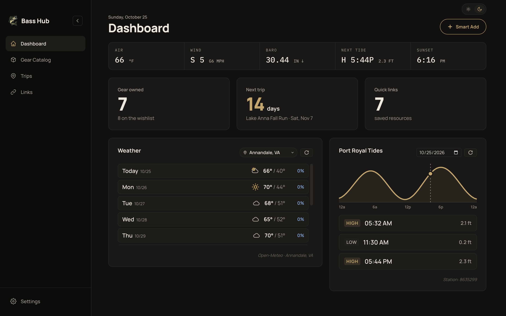
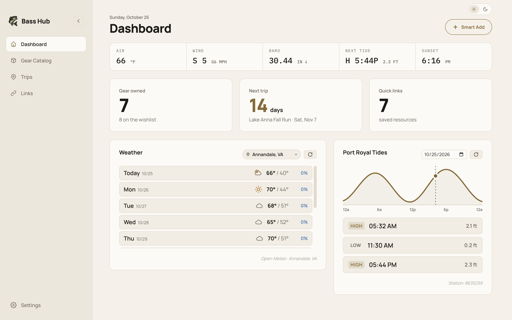
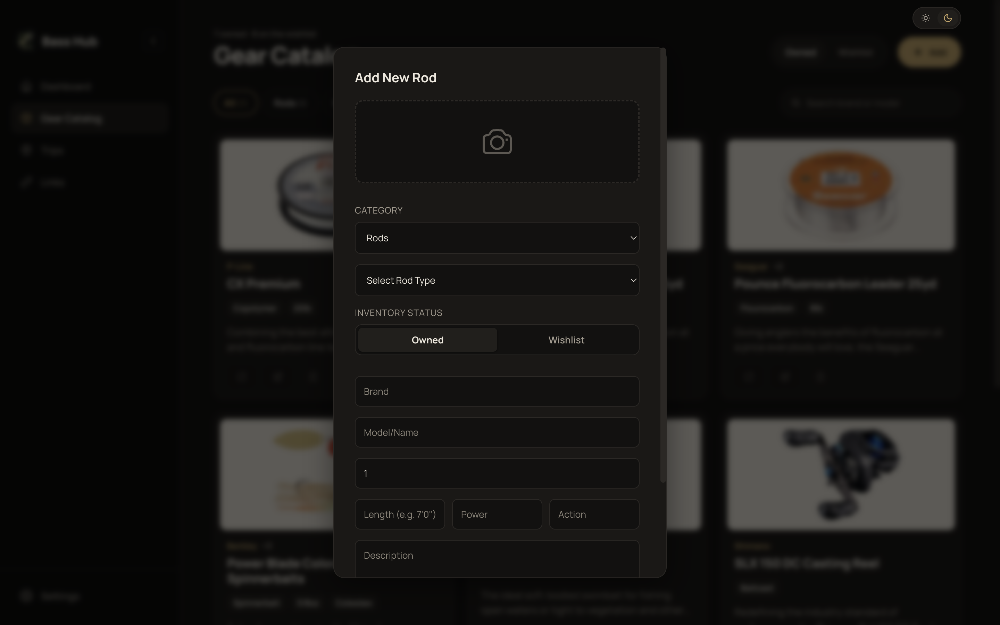
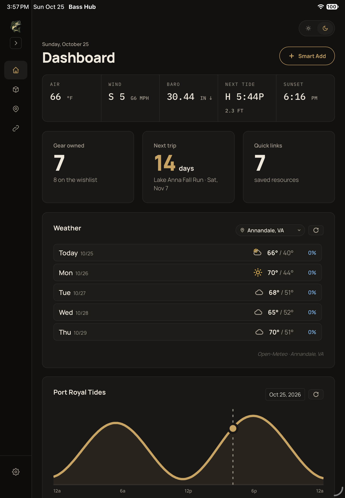
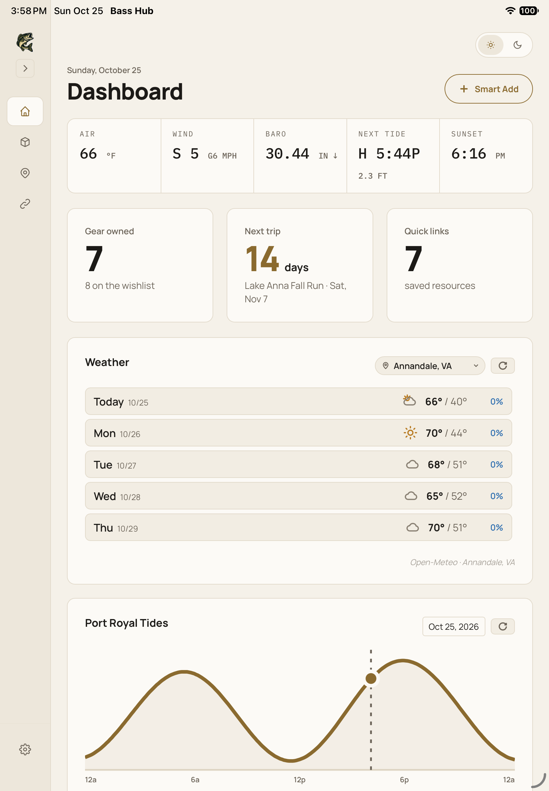

# Bass Hub

A local-first companion app for bass anglers: keep your tackle inventory and
wishlist, plan and log trips, save the links you keep going back to, and check
conditions on the water before you leave. It runs on macOS (Electron) and as a
native iPad app (Capacitor) from one shared React codebase. Your data stays on
your device in SQLite.

<p>
  
  
</p>

## Features

### Dashboard

Today's conditions at a glance. The strip across the top shows air temperature,
wind and gusts, barometric pressure with its trend, the next tide and sunset.
Below it: what you own, how many days until your next trip, your saved links, a
10-day forecast you can expand day by day (Open-Meteo), and the day's tide
curve for Port Royal on the Rappahannock (NOAA).

### Gear Catalog

Rods, reels, lures, line and terminal tackle, split into what you own and what
you want. Browse everything at once or filter by category, and search by brand
or model.

**Smart Add** fills in a new item from a product page: paste a URL from Tackle
Warehouse, Bass Pro Shops and similar sites, and Bass Hub reads the brand, model,
specs, description and photo for you. Items can re-fetch their product photo
later from the edit form.




### Trips

Plan upcoming trips and keep notes on past ones: dates, location, costs, links
and a journal. Each trip shows its location on a Google Map.


### Links

Group the sites you use (retailers, how-to videos, lodges) so they're one click
away.


### Settings

Set your Google Maps API key, back up or restore the whole database, and fill
in missing product photos for gear that has a product URL.


### Light and dark themes

Switch between the warm charcoal-and-brass dark theme and the ivory light theme
with the sun/moon toggle in the top-right corner. Your choice is remembered.

## Getting started (macOS)

**Requirements:** Node.js 18 or later and npm.

```bash
git clone https://github.com/richfdrums/bass-hub.git
cd bass-hub
npm install
cp .env.example .env   # then add your Google Maps key (optional)
npm start
```

`npm start` runs the app in development with hot reload. Trips show maps only
when a Google Maps key is set, either as `GOOGLE_MAPS_API_KEY` in `.env` or
under **Settings → Integrations**. The key needs the **Maps Embed API**
enabled. Everything else works without one.

To build the app:

```bash
npm run package   # Bass Hub.app in out/
npm run make      # distributable zip
```

## iPad app

The same interface runs natively on iPad, sharing the database code, the
scraper and every screen with the Mac app.

<p>
  
  
</p>

### Installing on your iPad

Requires a Mac with Xcode.

```bash
npm install
npm run build:ios   # builds the web bundle and syncs it into the Xcode project
npx cap open ios    # opens the project in Xcode
```

1. Connect the iPad, unlock it and tap **Trust** if asked.
2. In Xcode, choose the iPad as the run destination and press **⌘R**. The
   project uses automatic signing; to sign with your own Apple ID, change
   `DEVELOPMENT_TEAM` in `ios/App/App.xcodeproj/project.pbxproj` (or pick your
   team under *Signing & Capabilities*).
3. First run only, on the iPad:
   - turn on **Settings → Privacy & Security → Developer Mode** if iPadOS asks,
     and let it restart;
   - trust your profile under **Settings → General → VPN & Device Management**.

With a free Apple developer account the app stops opening after **7 days**.
Plug in and press ⌘R again to renew it; your data is kept.

`npm run assets:ios` regenerates the app icon and launch image from
`src/assets/logo.png`.

### Moving data between Mac and iPad

There's no sync: each device has its own database, and you move it as a single
file.

1. **Mac → iPad:** on the Mac, **Settings → Export .db File** and save it
   somewhere the iPad can reach (iCloud Drive, AirDrop). On the iPad,
   **Settings → Snapshots → Choose Snapshot** and confirm.
2. **iPad → Mac:** **Share Snapshot** on the iPad, then **Restore from File** on
   the Mac.

Importing **replaces** everything on the receiving device; it doesn't merge.
Both apps keep their last five automatic backups next to the database.

The design notes and decisions behind the iPad port are in
[`docs/ipad-port.md`](docs/ipad-port.md).

## How it's built

- **React** UI shared by both apps, styled with plain CSS and theme tokens
  (`src/index.css`); Manrope and IBM Plex Mono are bundled, so no fonts load
  from the network.
- **SQLite** behind one platform-neutral core (`src/core/`): `better-sqlite3`
  on the Mac, a small Swift plugin on the iPad.
- **Electron Forge + Vite** for the Mac app; **Capacitor** for the iPad.
- Weather from **Open-Meteo**, tides from **NOAA CO-OPS**, maps from the
  **Google Maps Embed API**.

```
bass-hub/
├── src/
│   ├── App.jsx          # app shell: navigation, theme
│   ├── components/      # screens and widgets (shared by both apps)
│   ├── core/            # database, backend API, Smart Add scraper (shared)
│   ├── shared/          # API types, platform detection
│   ├── main/            # Mac-only: better-sqlite3 adapter
│   ├── ios/             # iPad entry point and native plugin bindings
│   ├── main.js          # Electron main process
│   ├── preload.ts       # Electron preload bridge
│   └── index.css        # all styles and theme tokens
├── ios/                 # Capacitor Xcode project (Swift plugins live here)
├── scripts/             # iPad icon and launch image generator
├── docs/ipad-port.md    # iPad port notes
└── doc/                 # README screenshots
```

Contributor notes (architecture, conventions, how to add a feature on both
platforms) are in [`CLAUDE.md`](CLAUDE.md) and [`AGENTS.md`](AGENTS.md).

## License

MIT
