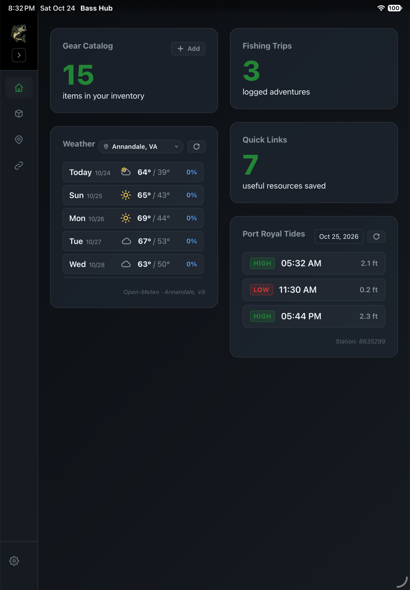

# Bass Hub

A comprehensive fishing gear and trip management application built with Electron and React.

Entirely vibe coded using Google's Antigravity IDE and its built-in agentic coding manager.

## Features

### Dashboard
Application entry point.  Displays simple widgets for gear catalog, trips, links, and an interactive tides module for Port Royal on the Rappahannock River.


### Gear Catalog
Manage your fishing rods, reels, lures, line, and terminal tackle.  Differentiates between owned gear and like-to-have (wishlist).  Features "smart add" functionality in which metadata information can be ingested from a provided product page URL (e.g., on Tackle Warehouse or BPS).


### Trip Planning
Log and plan fishing trips with location mapping


### Links
Save useful fishing resources and website links


### Settings
Allows for configuration of Google Maps API key (for Trips pages) and local DB export and restore.


## Setup

### Prerequisites

- Node.js (v16 or higher)
- npm

### Installation

1. Clone the repository
2. Install dependencies:
   ```bash
   npm install
   ```

3. Create a `.env` file in the root directory (use `.env.example` as a template):
   ```bash
   cp .env.example .env
   ```

4. Add your Google Maps API key to the `.env` file:
   ```
   GOOGLE_MAPS_API_KEY=your_api_key_here
   ```

### Development

Start the development server:
```bash
npm start
```

### Building

Package the application:
```bash
npm run package
```

Create distributable installers:
```bash
npm run make
```

## iPad app

The same UI also runs as a native iPad app (Capacitor + a small Swift SQLite
plugin). The React components, the SQLite schema, and the scraper are shared with
the Mac build — only the shell differs.



### Running it

```bash
npm install
npm run build:ios        # vite build + cap sync
npx cap open ios         # opens ios/App/App.xcodeproj in Xcode
```

In Xcode, pick your iPad and press ⌘R. The project is already pinned to a
**Personal Team** (`DEVELOPMENT_TEAM = X4NX2HG9CD` in `project.pbxproj`), so
automatic signing works without touching *Signing & Capabilities*. Building with
a different Apple ID only needs that one value changed.

The first launch is refused until the developer profile is trusted on the iPad:
**Settings → General → VPN & Device Management → Apple Development: … → Trust**.

A free Personal Team signature expires after **7 days**; after that the app stops
launching until you rebuild it from Xcode the same way. Nothing else is needed —
the database lives in the app container, so a rebuild keeps your data.

`npm run assets:ios` regenerates the app icon and launch image from
`src/assets/logo.png`.

### Moving data between the Mac and the iPad

There is no sync. Each device keeps its own database, and data travels as a whole
file that you copy yourself:

1. On the Mac: **Settings → Database Management → Export .db File**, save it
   somewhere both devices can see (iCloud Drive, AirDrop).
2. On the iPad: **Settings → Snapshots → Choose Snapshot**, pick that file, and
   confirm. This **replaces** everything on the iPad; it does not merge.
3. To go back the other way: **Share Snapshot** on the iPad, then
   **Restore from File** on the Mac.

The iPad is the authoritative copy by convention. Both platforms also keep the
last five invisible backups in `Application Support/backups` next to the database.

The plan, decisions and verification notes for the port are in
[`docs/ipad-port.md`](docs/ipad-port.md).

## Environment Variables

- `GOOGLE_MAPS_API_KEY`: Required for trip location mapping features

## Project Structure

```
bass-hub/
├── src/
│   ├── components/     # React components (shared by both apps)
│   ├── assets/         # Images and static files
│   ├── core/           # Platform-agnostic database + scraper (shared)
│   ├── shared/         # Types for window.fishingApi, platform detection
│   ├── main/           # Electron-only: better-sqlite3 adapter
│   ├── ios/            # iPad entry point + native plugin bindings
│   ├── App.jsx         # The whole UI
│   ├── main.js         # Electron main process
│   ├── preload.ts      # Preload script (desktop Api)
│   ├── renderer.jsx    # Desktop React entry point
│   └── index.css       # Global styles
├── ios/                # Capacitor Xcode project (Swift plugins live here)
├── scripts/            # ios-assets.swift: icon + launch image generator
├── docs/ipad-port.md   # How and why the iPad port was built
├── .env                # Environment variables (not in git)
├── .env.example        # Environment template
└── package.json
```

## Security

- API keys are stored in `.env` file (gitignored)
- Never commit the `.env` file to version control
- Use `.env.example` as a template for required variables

## License

MIT
