# Bass Hub

A comprehensive fishing gear and trip management application built with Electron and React.

Entirely vibe coded using Google's Antigravity IDE and its built-in agentic coding manager.

## Features

### Dashboard
Application entry point.  Displays simple widgets for gear catalog, trips, links, and an interactive tides module for Port Royal on the Rappahannock River.

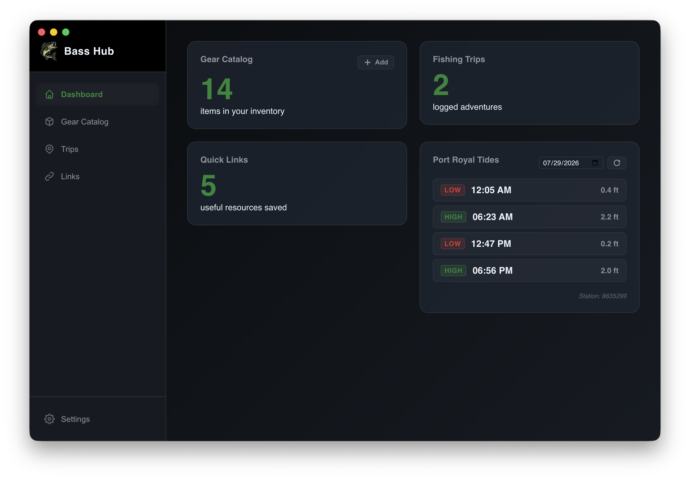

### Gear Catalog
Manage your fishing rods, reels, lures, line, and terminal tackle.  Differentiates between owned gear and like-to-have (wishlist).  Features "smart add" functionality in which metadata information can be ingested from a provided product page URL (e.g., on Tackle Warehouse or BPS).

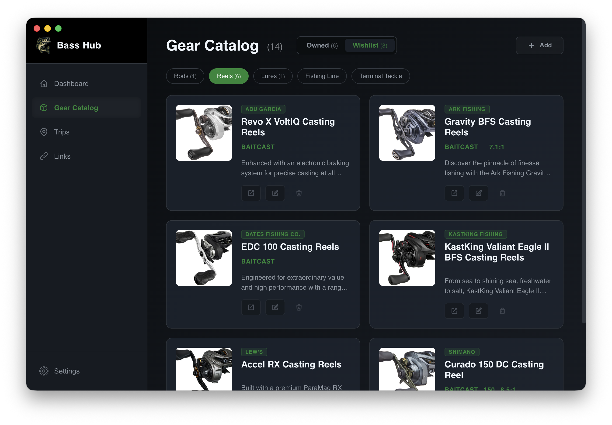
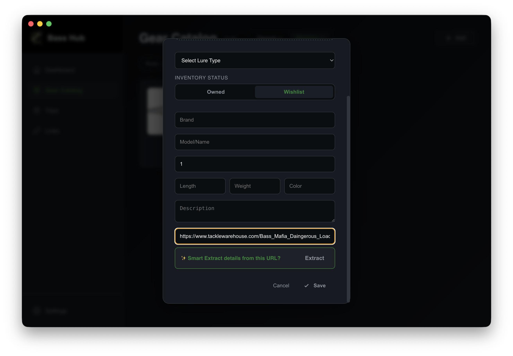
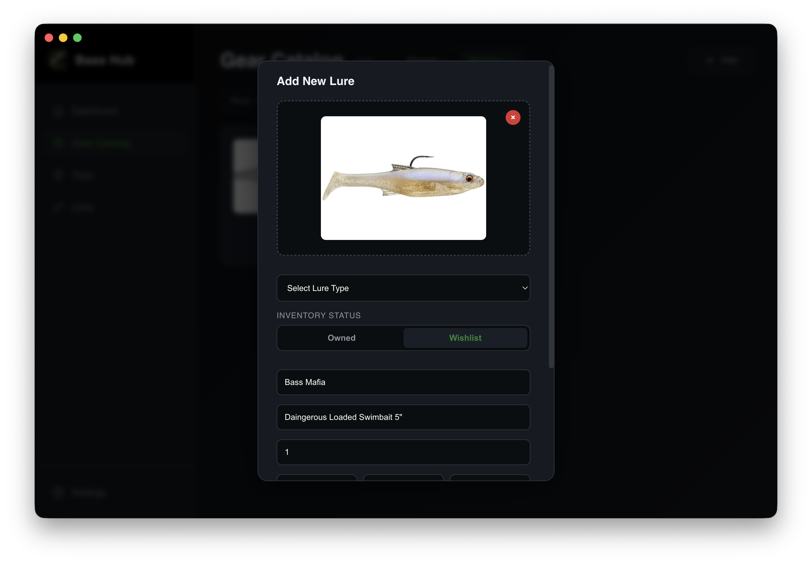

### Trip Planning
Log and plan fishing trips with location mapping

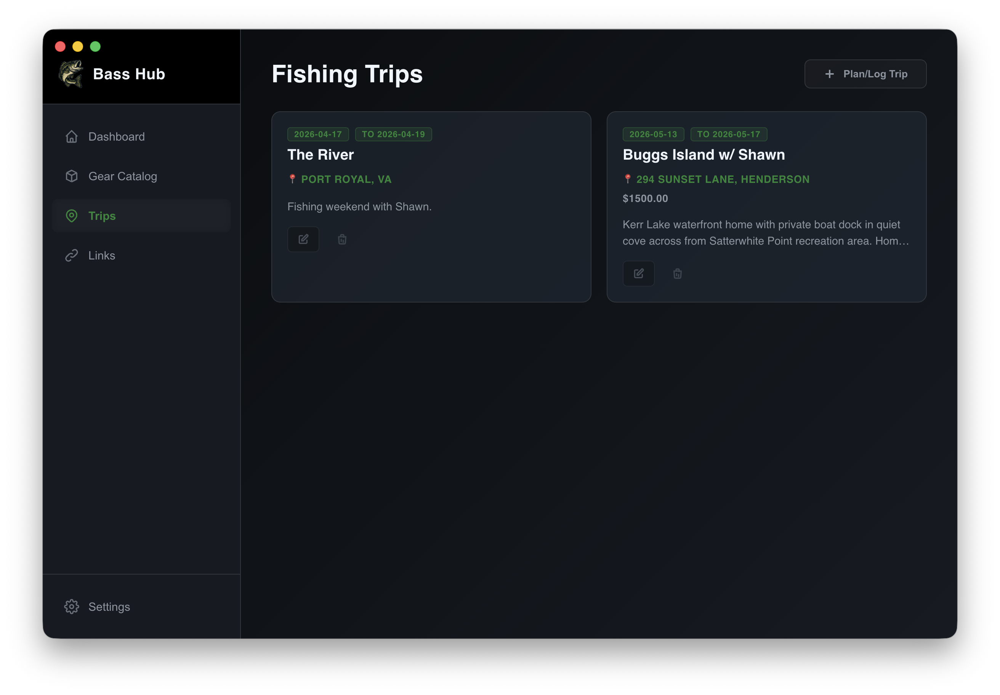
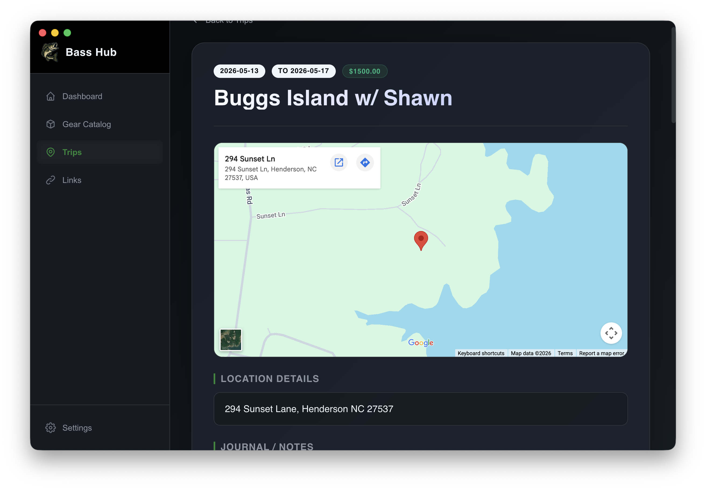
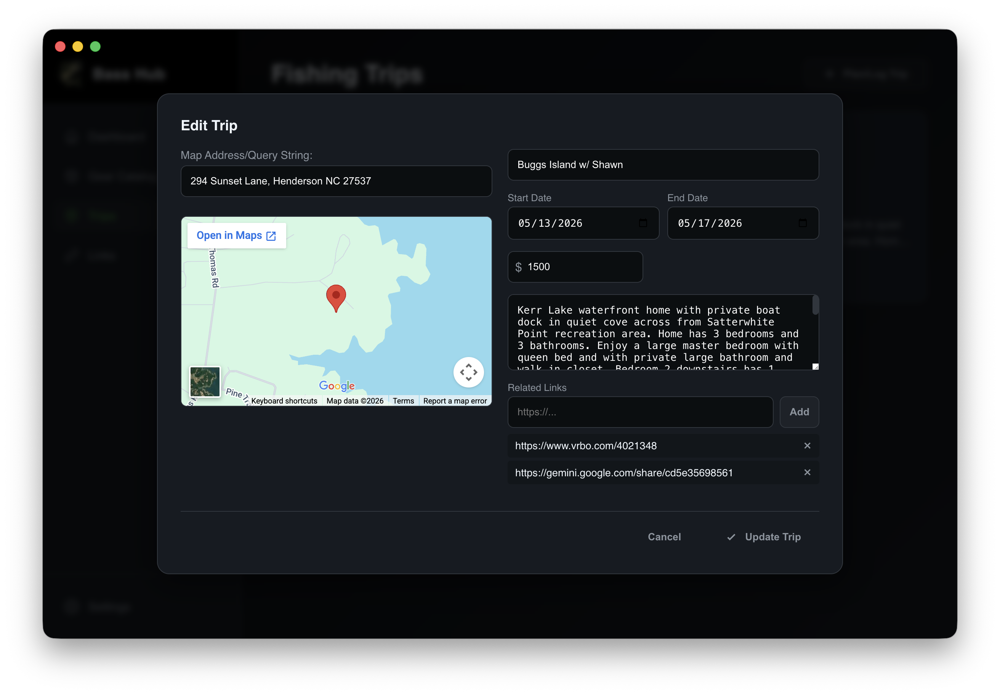
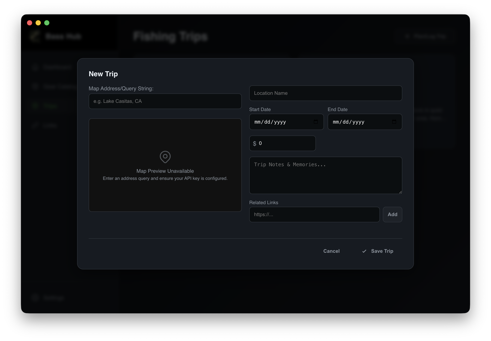

### Links
Save useful fishing resources and website links

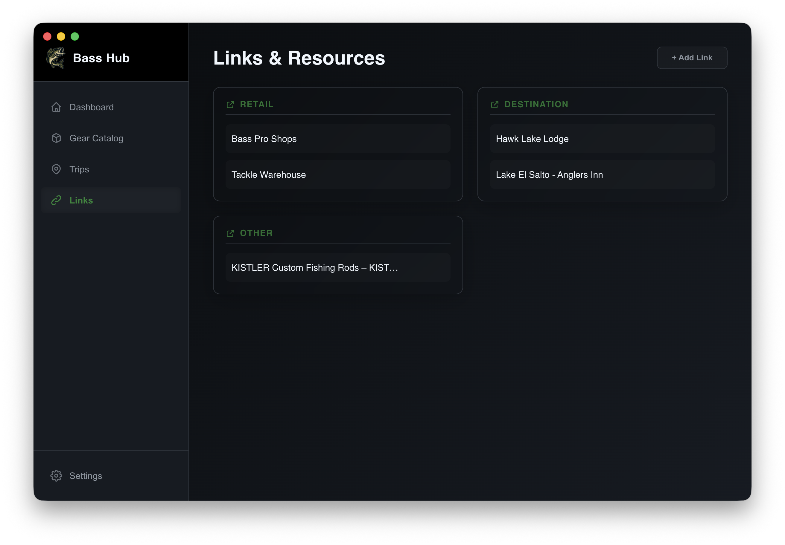
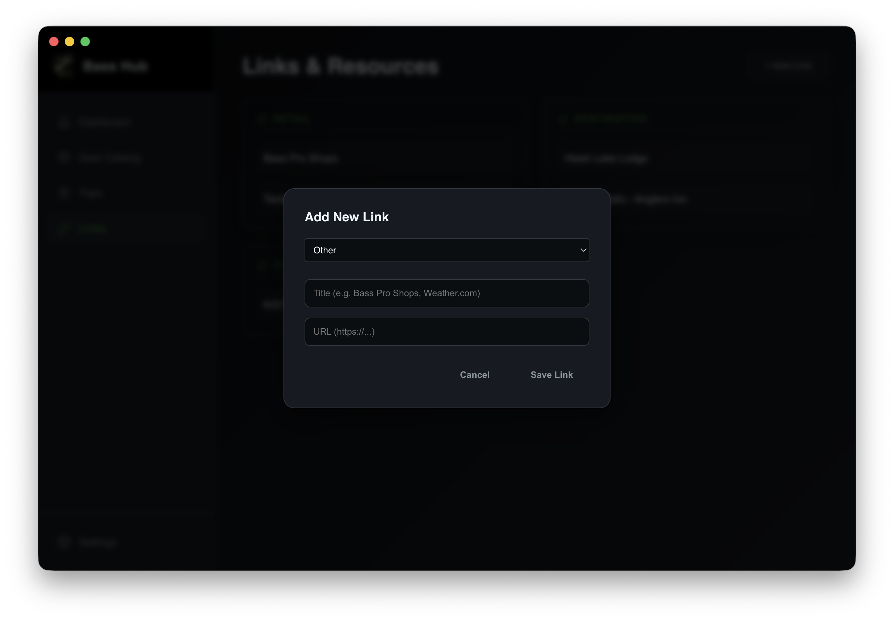

### Settings
Allows for configuration of Google Maps API key (for Trips pages) and local DB export and restore.

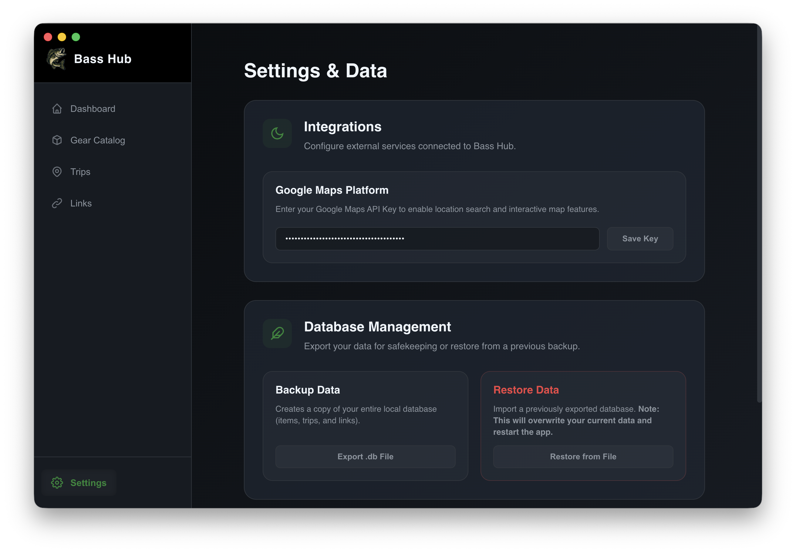


## Setup

### Prerequisites

- Node.js (v16 or higher)
- npm

### Installation

1. Clone the repository
2. Install dependencies:
   ```bash
   npm install
   ```

3. Create a `.env` file in the root directory (use `.env.example` as a template):
   ```bash
   cp .env.example .env
   ```

4. Add your Google Maps API key to the `.env` file:
   ```
   GOOGLE_MAPS_API_KEY=your_api_key_here
   ```

### Development

Start the development server:
```bash
npm start
```

### Building

Package the application:
```bash
npm run package
```

Create distributable installers:
```bash
npm run make
```

## Environment Variables

- `GOOGLE_MAPS_API_KEY`: Required for trip location mapping features

## Project Structure

```
bass-hub/
├── src/
│   ├── components/     # React components
│   ├── assets/         # Images and static files
│   ├── db.js          # Database layer
│   ├── main.js        # Electron main process
│   ├── preload.js     # Preload script
│   ├── renderer.jsx   # React entry point
│   └── index.css      # Global styles
├── .env               # Environment variables (not in git)
├── .env.example       # Environment template
└── package.json
```

## Security

- API keys are stored in `.env` file (gitignored)
- Never commit the `.env` file to version control
- Use `.env.example` as a template for required variables

## License

MIT
